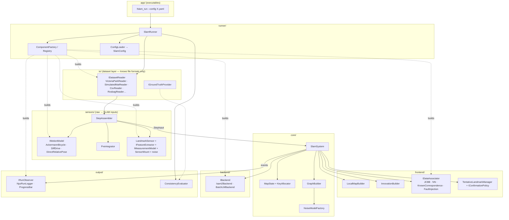
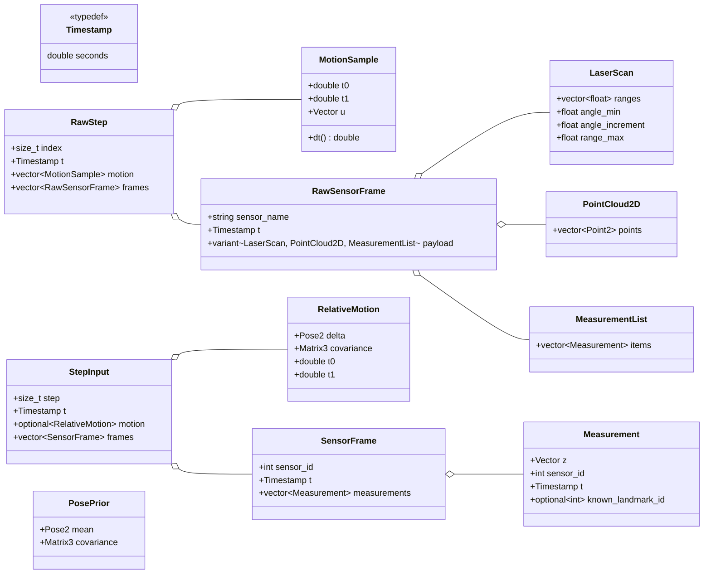
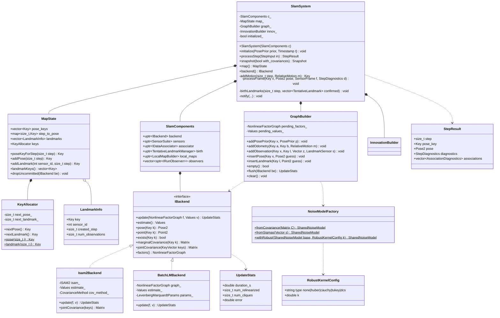

# 02 — C++ framework architecture

Namespace: `fslam`. Language: C++17 (C++20 optional). Core libs: **GTSAM 4.2** (factor graph,
iSAM2), **Eigen 3**, **yaml-cpp** (config), **Boost.Math** (χ² quantiles; already a GTSAM dep),
**cnpy** (write `.npz` so the existing Python plotting/evaluation keeps working), **spdlog**
(logging, optional), **GoogleTest**.

Scope decision: poses are **SE(2)** (`gtsam::Pose2`) and landmarks **2-D points** (`gtsam::Point2`),
like GA2. *Measurements* are of arbitrary dimension (`Eigen::VectorXd`), so range-bearing,
bearing-only, Cartesian points, … all fit. Moving to SE(3) later means templating the core on a
`PoseT/PointT` traits struct; the interfaces below are written so that this is mechanical.

> Diagram conventions: `vector~T~` = `std::vector<T>`, `optional~T~` = `std::optional<T>`,
> `uptr~T~` = `std::unique_ptr<T>`, `sptr~T~` = `std::shared_ptr<T>`. `<<interface>>` = pure
> abstract class. Methods ending in `$` are static. Arguments passed by `const&` are not marked.

---

## 1. Layers



Dependency rule: arrows point *down*; `core/` and `frontend/` never include anything from `io/`
or a concrete sensor. Adding a dataset touches `io/` only; adding a sensor touches `sensors/` only.

---

## 2. Core data types (`core/types.hpp`)



| Type | Replaces in GA2 | Notes |
|---|---|---|
| `MotionSample` | `WheelOdometry`, sim `odometry` row | `u` is interpreted by the `IMotionModel` (e.g. `[v, steer]`, `[v_l, v_r]`, `[dx, dy, dθ]`) |
| `RelativeMotion` | `relative_pose` + `relative_pose_cov` | Output of preintegration |
| `RawSensorFrame` | `RawLidarStepInput.scan` | Variant payload: add a new alternative for e.g. images/fiducials |
| `RawStep` | `RawLidarStepInput` / sim dict | What a reader yields — no processing |
| `StepInput` | `SlamStepInput` | What `SlamSystem` consumes — fully processed, possibly multi-sensor |
| `Measurement::known_landmark_id` | — | For datasets with ground-truth correspondences (e.g. UTIAS MRCLAM) |

---

## 3. Input layer: datasets, motion, sensors (`io/`, `sensors/`)

```mermaid
classDiagram
    direction TB

    class IDatasetReader {
        <<interface>>
        +name() string
        +open(YAML params) void
        +initialPose() PosePrior
        +hasNext() bool
        +next() RawStep
        +sizeHint() optional~size_t~
        +groundTruth() IGroundTruthProvider_ptr
    }
    class VictoriaParkReader {
        -Matrix lsr_scans_
        -Vector lsr_t_, odo_t_, odo_v_, odo_steer_
        -Matrix gnss_
        -size_t lidar_idx_
        -double initial_heading_
        +open(YAML params) void
        +next() RawStep
        -odometryBetween(t0, t1) vector~MotionSample~
        -loadMat(path) void
    }
    class SimulatedMatReader {
        -vector~Matrix~ z_
        -Matrix odometry_, poses_gt_, landmarks_gt_
        +next() RawStep
        +observedLandmarks(n) vector~int~
    }
    class CsvDatasetReader {
        -columns mapping from YAML
        +next() RawStep
    }
    class IGroundTruthProvider {
        <<interface>>
        +poseAt(Timestamp t) optional~Pose2~
        +landmarks() optional~Matrix~
        +gnss() optional~Matrix~
        +observedLandmarks(n) vector~int~
    }
    IDatasetReader <|.. VictoriaParkReader
    IDatasetReader <|.. SimulatedMatReader
    IDatasetReader <|.. CsvDatasetReader
    IDatasetReader ..> IGroundTruthProvider

    class IMotionModel {
        <<interface>>
        +name() string
        +inputDim() int
        +relativePose(MotionSample s) Pose2
        +covariance(MotionSample s) Matrix3
    }
    class AckermannBicycleModel {
        -double wheelbase_L
        -double encoder_offset_H
        -Matrix3 Q_per_second
        +relativePose(s) Pose2
        +covariance(s) Matrix3
    }
    class DifferentialDriveModel {
        -double track_width
        -Matrix3 Q_per_second
    }
    class DirectRelativePoseModel {
        -Matrix3 Q
        +relativePose(s) Pose2
    }
    IMotionModel <|.. AckermannBicycleModel
    IMotionModel <|.. DifferentialDriveModel
    IMotionModel <|.. DirectRelativePoseModel

    class Preintegrator {
        -Pose2 delta_
        -Matrix3 cov_
        -double t0_, t1_
        -size_t count_
        +reset(Timestamp t) void
        +integrate(Pose2 inc, Matrix3 inc_cov, double t1) void
        +integrate(IMotionModel m, MotionSample s) void
        +empty() bool
        +result() RelativeMotion
    }
    Preintegrator ..> IMotionModel

    class IFeatureExtractor {
        <<interface>>
        +name() string
        +extract(RawSensorFrame f) vector~Vector~
    }
    class TreeDetector {
        -TreeDetectorParams p
        -double max_range
        +extract(f) vector~Vector~
        -segment(LaserScan) ...
    }
    class PassThroughExtractor {
        +extract(f) vector~Vector~
    }
    class ClusterCentroidExtractor {
        -double cluster_tol
        -int min_points
    }
    IFeatureExtractor <|.. TreeDetector
    IFeatureExtractor <|.. PassThroughExtractor
    IFeatureExtractor <|.. ClusterCentroidExtractor

    class IMeasurementModel {
        <<interface>>
        +name() string
        +dim() int
        +predict(Pose2 T_wb, Point2 l, Matrix_ptr H_pose, Matrix_ptr H_lm) Vector
        +residual(Vector z, Vector z_hat) Vector
        +inverse(Pose2 T_wb, Vector z) optional~Point2~
        +isVisible(Vector z_hat) bool
        +makeFactor(Key x, Key l, Vector z, SharedNoiseModel n) NonlinearFactor_sptr
        +setMount(SensorMount m) void
    }
    class RangeBearingModel {
        -SensorMount mount_
        -FovGate fov_
        +dim() int = 2
        +residual() wraps bearing
        +makeFactor() BearingRangeFactor or ExpressionFactor
    }
    class BearingOnlyModel {
        +dim() int = 1
        +inverse() nullopt (delayed init)
    }
    class CartesianPointModel {
        +dim() int = 2
        +predict() T_ws.inverse * l
    }
    IMeasurementModel <|.. RangeBearingModel
    IMeasurementModel <|.. BearingOnlyModel
    IMeasurementModel <|.. CartesianPointModel

    class SensorMount {
        +Pose2 T_body_sensor
    }
    class FovGate {
        +double max_range
        +double half_fov_rad
        +contains(range, bearing) bool
    }

    class LandmarkSensor {
        +int id
        +string name
        +uptr~IFeatureExtractor~ extractor
        +uptr~IMeasurementModel~ model
        +SensorMount mount
        +Matrix R
        +SharedNoiseModel noise
        +FovGate local_map_gate
        +process(RawSensorFrame f) SensorFrame
    }
    LandmarkSensor *-- IFeatureExtractor
    LandmarkSensor *-- IMeasurementModel
    LandmarkSensor *-- SensorMount
    LandmarkSensor *-- FovGate

    class SensorSuite {
        -vector~LandmarkSensor~ sensors_
        -map~string,int~ by_name_
        +add(LandmarkSensor s) int
        +get(int id) LandmarkSensor
        +byName(string) LandmarkSensor
        +size() size_t
    }
    SensorSuite o-- LandmarkSensor

    class StepAssembler {
        -IMotionModel_ptr motion_
        -SensorSuite_ptr sensors_
        -Preintegrator preint_
        -IKeyframePolicy_ptr keyframes_
        +assemble(RawStep raw) optional~StepInput~
    }
    class IKeyframePolicy {
        <<interface>>
        +isKeyframe(RawStep raw, Preintegrator p) bool
    }
    class EveryFramePolicy
    class MotionThresholdPolicy {
        -double min_dist, min_angle, max_dt
    }
    IKeyframePolicy <|.. EveryFramePolicy
    IKeyframePolicy <|.. MotionThresholdPolicy
    StepAssembler --> IMotionModel
    StepAssembler --> SensorSuite
    StepAssembler *-- Preintegrator
    StepAssembler --> IKeyframePolicy
```



### Notes per class

- **`IDatasetReader`** — pure I/O + unit conversion (cm→m, ms→s). It never looks at noise or
  SLAM settings: this is the split between GA2's `iterate()` (raw) and `iterate_slam(config)`
  (processed). `VictoriaParkReader::next()` reproduces `_odometry_between` (clip encoder intervals
  to `[t_{k-1}, t_k]`) and emits one `RawStep` per lidar scan starting at index 2.
  `SimulatedMatReader` emits `MotionSample{u=[dx,dy,dθ]}` + a `MeasurementList` frame (already
  range-bearing) so it goes through `DirectRelativePoseModel` + `PassThroughExtractor`.
- **`IMotionModel`** — `AckermannBicycleModel` is GA2's `relative_pose`:
  `v_b = v_e / (1 − (H/L)·tan δ)`, `ω = v_b·tan δ / L`, `Pose2::Expmap([v_b, 0, ω]·dt)`;
  `covariance(s) = Q_per_second · dt` (the `odom_cov * dt` that GA2 hid inside the loader).
- **`Preintegrator`** — GA2's `preintegrate`: `delta = delta.compose(inc, H1, H2)`,
  `cov = H1 cov H1ᵀ + H2 Q H2ᵀ`. Not reset between non-keyframe raw steps, so a keyframe policy
  can skip scans without losing odometry.
- **`IMeasurementModel`** — the seam that makes the framework sensor-agnostic. Everything that
  in GA2 assumed `[range, bearing]` (`predict_measurement`, `inverse_measurement`,
  `ssa(dz[1])`, the `2*L` blocks in JCBB, `BearingRangeFactor2D`) goes through it.
  `predict` applies the mount: `T_ws = T_wb ∘ T_bs`; Jacobians are w.r.t. the *body* pose (chain
  rule through the constant mount). `makeFactor` for a non-identity mount uses a
  `gtsam::ExpressionFactor` (`bearing(transformPoseTo(...))`) or a small custom factor.
  Factor/noise ordering quirks (GTSAM wants `[bearing, range]`, the framework uses `[range, bearing]`)
  live **only** inside `RangeBearingModel`.
- **`LandmarkSensor`** — a bundle, not an interface: one per physical sensor in the YAML. GA2 had
  exactly one implicit instance.
- **`StepAssembler`** — `assemble(raw)`: feeds every `MotionSample` into the preintegrator, runs
  each frame's sensor `process()`, and returns a `StepInput` only when the keyframe policy fires
  (default `EveryFramePolicy` = GA2 behaviour).

---

## 4. Front-end (`frontend/`)

```mermaid
classDiagram
    direction TB

    class LocalMapEntry {
        +Key key
        +Point2 position
        +Vector z_hat
        +Matrix H_pose
        +Matrix H_lm
    }
    class LocalMap {
        +int sensor_id
        +Key pose_key
        +vector~LocalMapEntry~ entries
        +size() size_t
        +keys() KeyVector
        +predictedStacked() Vector
        +measDim() int
    }
    LocalMap o-- LocalMapEntry

    class LocalMapBuilder {
        +build(Pose2 pose, Key pose_key, MapState map, IBackend be, LandmarkSensor s) LocalMap
    }
    class ISpatialIndex {
        <<interface>>
        +insert(Key k, Point2 p) void
        +update(Key k, Point2 p) void
        +radiusQuery(Point2 c, double r) vector~Key~
    }
    class BruteForceIndex
    class GridIndex {
        -double cell_size
    }
    ISpatialIndex <|.. BruteForceIndex
    ISpatialIndex <|.. GridIndex
    LocalMapBuilder --> ISpatialIndex

    class InnovationBuilder {
        +jointCovariance(IBackend be, LocalMap lm) Matrix
        +innovation(LocalMap lm, Matrix P, Matrix R) Matrix
    }

    class Association {
        +vector~int~ pairs
        +double joint_nis
        +numAssociated() int
        +associatedIdx() vector~int~
        +unassociatedIdx() vector~int~
    }
    class AssociationContext {
        +vector~Measurement~ z
        +LocalMap local_map
        +Matrix S
        +IMeasurementModel model
        +size_t step
    }
    class IDataAssociator {
        <<interface>>
        +name() string
        +associate(AssociationContext ctx) Association
    }
    class JcbbAssociator {
        -double alpha_individual
        -double alpha_joint
        -Chi2Cache chi2_
        +associate(ctx) Association
        -recurse(j, a, ic, best) void
        -individualCompatibility(ctx) Matrix
        -jointNis(ctx, a) double
    }
    class NearestNeighbourAssociator {
        -double alpha_gate
        -bool one_to_one_hungarian
    }
    class KnownCorrespondenceAssociator {
        -map~int,Key~ id_to_key
    }
    class FaultInjectionAssociator {
        -uptr~IDataAssociator~ inner
        -set~size_t~ inject_steps
        +associate(ctx) Association
    }
    IDataAssociator <|.. JcbbAssociator
    IDataAssociator <|.. NearestNeighbourAssociator
    IDataAssociator <|.. KnownCorrespondenceAssociator
    IDataAssociator <|.. FaultInjectionAssociator
    FaultInjectionAssociator o-- IDataAssociator : decorates
    IDataAssociator ..> AssociationContext
    IDataAssociator ..> Association

    class Chi2Cache {
        +inverseSurvival(double p, int dof) double
    }
    JcbbAssociator *-- Chi2Cache

    class SupportingObservation {
        +size_t step
        +Key pose_key
        +int sensor_id
        +Vector z
    }
    class TentativeLandmark {
        +Point2 position
        +vector~SupportingObservation~ support
        +hitCount() size_t
        +lastSeenStep() size_t
        +update(Point2 p, SupportingObservation o) void
    }
    TentativeLandmark o-- SupportingObservation

    class IConfirmationPolicy {
        <<interface>>
        +isConfirmed(TentativeLandmark t, size_t step) bool
        +isDead(TentativeLandmark t, size_t step) bool
    }
    class MofNPolicy {
        -int M
        -int N
    }
    IConfirmationPolicy <|.. MofNPolicy

    class TentativeLandmarkManager {
        -vector~TentativeLandmark~ tentative_
        -uptr~IConfirmationPolicy~ policy_
        -double gate_
        +addObservations(size_t step, vector~SupportingObservation~ obs, vector~Point2~ positions) vector~TentativeLandmark~
        +prune(size_t step) void
        +reset() void
        +size() size_t
        +tentative() vector~TentativeLandmark~
        -match(vector~Point2~ p) vector~int~
        -spawn(Point2 p, SupportingObservation o) void
        -extractConfirmed(size_t step) vector~TentativeLandmark~
    }
    TentativeLandmarkManager o-- TentativeLandmark
    TentativeLandmarkManager *-- IConfirmationPolicy
    TentativeLandmarkManager ..> HungarianSolver

    class HungarianSolver {
        +solve(Matrix cost)$ vector~IndexPair~
    }
```



### Notes per class

- **`LocalMapBuilder`** — GA2 `extract_local_map`, but the visibility test is the sensor's
  `local_map_gate` and predictions/Jacobians come from the sensor's `IMeasurementModel`. With
  thousands of landmarks the O(L) loop becomes the bottleneck → optional `ISpatialIndex`
  (grid hash) to pre-filter by radius. GA2 behaviour = `BruteForceIndex`.
- **`InnovationBuilder`** — `jointCovariance` = `backend.jointMarginalCovariance([X_k, L…])`
  + GA2's `assemble_joint_covariance` (block assembly with per-key dimensions);
  `innovation` = GA2's `innovation_covariance` generalised to measurement dim `m`:
  `H` is `(m·n) × (3 + 2n)`, `R_big = I_n ⊗ R`, `S = H P Hᵀ + R_big`.
- **`JcbbAssociator`** — one-to-one port of `JCBB_association` / `_jcbb_recursive` /
  `individual_compatibility` / `NIS`, but:
  block size is `ctx.model.dim()` instead of `2`, the residual is `ctx.model.residual()`
  (no hard-coded `ssa` on index 1), χ² quantiles come from `boost::math::quantile(complement(chi_squared(dof), 1-α))`
  cached in `Chi2Cache`, and the joint NIS uses an Eigen `LLT` on the selected sub-block.
- **`FaultInjectionAssociator`** — GA2's Task-4 `force_wrong_association` as a *decorator*
  instead of an `if` in the main loop.
- **`KnownCorrespondenceAssociator`** — for datasets that label landmarks (lets you test the
  back-end with perfect association).
- **`TentativeLandmarkManager`** — GA2 code: Hungarian matching inside a Euclidean gate
  (`HungarianSolver` ≈ `scipy.linear_sum_assignment`, ~100 lines or use a header-only lib),
  running-average position, M-of-N policy. `SupportingObservation` now stores `sensor_id` and
  `pose_key` so that, on confirmation, the right model creates the factors on past poses.

---

## 5. Core + back-end (`core/`, `backend/`)



### Notes per class

- **`MapState`** replaces GA2's `SlamState` key lists. It decouples *step index* from *pose index*
  (`step_to_pose`): with a keyframe policy or a dropped scan they differ, which GA2's `X(k)`
  assumption couldn't handle.
- **`GraphBuilder`** replaces `SlamState.new_factors / new_values / update_and_clear` and the
  `add_*_factor` free functions. `addObservation` delegates factor creation to
  `sensor.model->makeFactor(x, l, z, sensor.noise)` — no factor type is hard-coded here.
  `addOdometry` = `BetweenFactor<Pose2>` with `noiseModel::Gaussian::Covariance(m.covariance)`.
- **`IBackend`** — GA2 `Backend`. `Isam2Backend` uses `ISAM2::jointMarginalCovariance`
  (`bayes_tree`) or `gtsam::Marginals(getFactorsUnsafe(), estimate)` (`marginals`).
  `BatchLMBackend` re-solves from scratch (for small/sim debugging). Room for a
  `FixedLagBackend` (`IncrementalFixedLagSmoother`) later.
- **`SlamSystem`** is `run_slam` minus I/O: it is a library object you can drive from a test,
  a ROS node, or the CLI. `processStep` algorithm is in [03_runtime_flow.md](03_runtime_flow.md).

---

## 6. Runner, config, factory, output (`runner/`, `output/`)

```mermaid
classDiagram
    direction TB

    class SlamConfig {
        +YAML dataset
        +YAML motion_model
        +vector~YAML~ sensors
        +YAML keyframes
        +YAML association
        +YAML landmark_birth
        +YAML backend
        +YAML logging
        +PosePrior initial_pose_override
        +load(path)$ SlamConfig
        +save(path) void
    }

    class Registry~Interface~ {
        -map~string, Creator~ creators_
        +instance()$ Registry
        +add(string name, Creator c) bool
        +create(string name, YAML params) uptr~Interface~
        +names() vector~string~
    }
    class ComponentFactory {
        +makeReader(YAML n)$ uptr~IDatasetReader~
        +makeMotionModel(YAML n)$ uptr~IMotionModel~
        +makeSensorSuite(vector~YAML~ n)$ sptr~SensorSuite~
        +makeAssociator(YAML n)$ uptr~IDataAssociator~
        +makeBirth(YAML n)$ uptr~TentativeLandmarkManager~
        +makeBackend(YAML n)$ uptr~IBackend~
        +makeKeyframePolicy(YAML n)$ uptr~IKeyframePolicy~
        +makeObservers(YAML n, path run_dir)$ vector~sptr~IRunObserver~~
    }
    ComponentFactory ..> Registry
    ComponentFactory ..> SlamConfig

    class SlamRunner {
        -SlamConfig cfg_
        -path run_dir_
        -optional~size_t~ max_steps_
        -atomic~bool~ stop_requested_
        +SlamRunner(SlamConfig cfg, path run_dir, optional~size_t~ max_steps)
        +run() RunResult
        +requestStop() void
        -installSigintHandler() void
    }
    SlamRunner ..> ComponentFactory
    SlamRunner ..> SlamSystem
    SlamRunner ..> StepAssembler
    SlamRunner ..> IDatasetReader

    class IRunObserver {
        <<interface>>
        +onStart(SlamConfig cfg, IDatasetReader ds) void
        +onStep(StepResult r) void
        +wantsSnapshot(size_t step) bool
        +onSnapshot(size_t step, Snapshot s) void
        +onFinish(RunMetadata m, Snapshot final) void
    }
    class NpzRunLogger {
        -path run_dir_
        -LoggingConfig cfg_
        -vector~StepDiagnostics~ steps_
        +onStep(r) void
        +onSnapshot(step, s) void
        +onFinish(m, s) void
        -writeAssociation(AssociationDiagnostics a) void
    }
    class ProgressBarObserver
    class ConsoleSummaryObserver
    IRunObserver <|.. NpzRunLogger
    IRunObserver <|.. ProgressBarObserver
    IRunObserver <|.. ConsoleSummaryObserver

    class StepDiagnostics {
        +size_t scan_step
        +double scan_time
        +size_t num_landmarks, num_local_landmarks
        +size_t num_associated, num_unassociated
        +size_t num_tentative
        +double duration_step, duration_optimization
        +double duration_association, duration_covariance
        +double duration_local_map
    }
    class AssociationDiagnostics {
        +size_t step
        +int sensor_id
        +Pose2 pose
        +Matrix z, z_hat
        +vector~int~ association
        +Matrix local_landmarks
        +vector~Key~ local_keys
        +Matrix P, S
    }
    class Snapshot {
        +Matrix poses  n x 3
        +vector~Matrix3~ pose_covs
        +Matrix landmarks  m x 2
        +vector~Matrix2~ landmark_covs
    }
    class ScopedTimer {
        -double ref
        +ScopedTimer(double ref)
        +destructor() adds elapsed to ref
    }
    NpzRunLogger ..> StepDiagnostics
    NpzRunLogger ..> AssociationDiagnostics
    NpzRunLogger ..> Snapshot

    class ConsistencyEvaluator {
        +poseErrors(Matrix est, Matrix gt)$ Matrix
        +poseNees(Matrix est, Matrix gt, vector~Matrix3~ P)$ Vector
        +landmarkNis(vector~AssociationDiagnostics~ d)$ Vector
        +gnssNis(Matrix poses, Matrix gnss, double sigma)$ Vector
        +mapQuality(Matrix lm, Matrix lm_gt, vector~int~ observed)$ MapQuality
        +chi2Interval(int dof, double conf)$ pair
        +summarize(Snapshot s, IGroundTruthProvider gt)$ RunSummary
    }
    class MapQuality {
        +observed
        +found
        +duplicates
        +spurious
        +rms_error_m
    }
    class RunSummary {
        +rmse_xyyaw
        +pose_anees
        +landmark_anis
        +gnss_anis
        +map_quality
    }
    ConsistencyEvaluator ..> MapQuality
    ConsistencyEvaluator ..> RunSummary
    SlamRunner ..> ConsistencyEvaluator
```



### Registration (the "factory")

Every concrete class self-registers in its `.cpp`, so the core never `#include`s it:

```cpp
// sensors/motion/ackermann_bicycle.cpp
FSLAM_REGISTER(IMotionModel, AckermannBicycleModel, "ackermann_bicycle");

// the macro expands to:
namespace { const bool reg_ = fslam::Registry<fslam::IMotionModel>::instance().add(
    "ackermann_bicycle",
    [](const YAML::Node& p) { return std::make_unique<AckermannBicycleModel>(p); }); }
```

(Link the component libraries with `-Wl,--whole-archive` / CMake `OBJECT` libraries, or call an
explicit `registerBuiltins()` once, so the static registrars aren't dropped by the linker.)

### Config: same framework, different datasets

```yaml
# configs/victoria_park.yaml  — reproduces GA2 real_default.yaml
dataset:
  type: victoria_park
  params: { folder: data/victoria_park/raw, initial_heading_deg: 36.0, start_index: 2 }
motion_model:
  type: ackermann_bicycle
  params: { wheelbase: 2.83, encoder_offset: 0.76,
            sigma_per_sqrt_s: { x: 0.1, y: 0.1, yaw_deg: 0.1 } }
initial_pose_sigma: { x: 0.05, y: 0.05, yaw_deg: 0.5 }
keyframes: { type: every_frame }
sensors:
  - name: laser
    extractor: { type: tree_detector, params: { max_range: 50.0 } }
    model:     { type: range_bearing }
    mount:     { x: 0.0, y: 0.0, yaw_deg: 0.0 }   # GA2 ignores Car.a/b; set {x: 3.78, y: 0.5} to use them
    noise:     { sigmas: [0.2, 1.0deg] , robust: { type: none } }
    local_map: { max_range: 50.0, half_fov_deg: 125.0 }
association:
  type: jcbb
  params: { alpha_individual: 0.999, alpha_joint: 0.9999 }
  # fault_injection: { steps: [1200] }          # Task 4
landmark_birth:
  policy: { type: m_of_n, params: { M: 3, N: 4 } }
  gate: 0.1
backend:
  type: isam2
  params: { relinearize_threshold: 0.1, relinearize_skip: 10, covariance: bayes_tree }
logging: { association_stride: 200, snapshot_stride: 200 }
```

```yaml
# configs/simulated.yaml
dataset:      { type: simulated_mat, params: { file: data/simulated/simulatedSLAM.mat } }
motion_model: { type: direct_relative_pose, params: { sigmas: { x: 0.1, y: 0.1, yaw_deg: 0.1 } } }
sensors:
  - name: sim_rb
    extractor: { type: pass_through }
    model:     { type: range_bearing }
    noise:     { sigmas: [0.05, 1.0deg] }
    local_map: { max_range: 50.0, half_fov_deg: 125.0 }
# ... association/backend as above
```

```yaml
# configs/my_robot.yaml  — hypothetical: diff-drive robot, 2D lidar + camera with fiducials
dataset:      { type: csv, params: { odom: odom.csv, scans: scans.csv, tags: tags.csv } }
motion_model: { type: differential_drive, params: { track_width: 0.45 } }
keyframes:    { type: motion_threshold, params: { min_dist: 0.3, min_angle_deg: 10, max_dt: 1.0 } }
sensors:
  - name: lidar
    extractor: { type: cluster_centroid, params: { cluster_tol: 0.2, min_points: 4 } }
    model:     { type: range_bearing }
    mount:     { x: 0.20, y: 0.0, yaw_deg: 0.0 }
    noise:     { sigmas: [0.03, 0.5deg], robust: { type: huber, k: 1.345 } }
  - name: camera_tags
    extractor: { type: pass_through }
    model:     { type: cartesian_point }
    mount:     { x: 0.10, y: 0.05, yaw_deg: 0.0 }
    noise:     { sigmas: [0.05, 0.05] }
association: { type: nearest_neighbour, params: { alpha_gate: 0.99 } }
```
